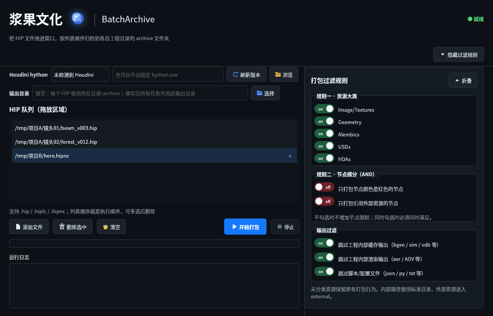
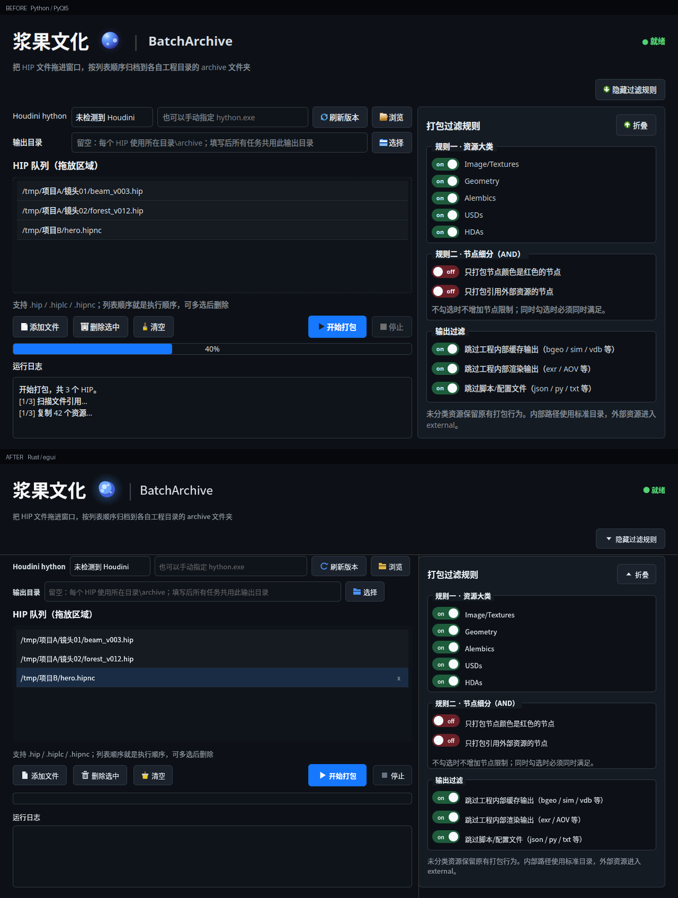

# BatchArchive (Rust shell)

Houdini HIP 批量归档工具的 **Rust 外壳原型**。



与原 PyQt5 界面对照（上：原版，下：Rust 版）：


目标是把「发给同事/外包就能直接跑」这件事做掉：单文件 exe，不要求机器上有 Python，不联网装 PyQt5。

## 架构：为什么不是全 Rust

`hou` 只存在于 hython 进程里。`hou.fileReferences()`、`parm.evalAsString()`、节点颜色、`hipFile.load/save()` 没有 Rust 等价物，硬绑只能走 HDK 或 pyo3 嵌 Python，代价远高于收益。

所以边界这样切：

```
┌─────────────────────────────┐
│ Rust (eframe/egui)          │  ← 单 exe，约 10MB
│  队列 / UI / 进程 / IO      │
│  manifest 类型化校验        │
└──────────┬──────────────────┘
           │ hython.exe -u <script> ...
┌──────────▼──────────────────┐
│ Python (package_houdini.py) │  ← 随 exe 内嵌，运行时释放到 %TEMP%
│  hou 内省 / 复制 / 改写     │
└─────────────────────────────┘
```

`package_houdini.py` 与原项目完全一致（未改动一行），协议也沿用原来的 stdout JSON lines（`emit("status", ...)` / `emit("done", ...)`），因此 Python 侧可以独立调试、独立演进。

## UI 对齐

界面不是"照着感觉做一个深色 UI"，而是把原 PyQt5 版的**几何与色值逐项抄过来**。原版 `app.py` 的 QSS + `_build_ui()` 就是唯一的规格来源，关键数字全部写进 `src/app.rs` 顶部常量：

| 项 | 原版来源 | 复刻值 |
|---|---|---|
| 窗口边距 | `root.setContentsMargins(24, 22, 24, 20)` | `MARGIN_X/TOP/BOTTOM` |
| 块间距 | `root.setSpacing(12)` | `BLOCK_GAP` |
| 输入框 / 按钮高度 | `padding:7px` / `padding:8px 13px` | 一律 38px（主按钮 42px） |
| 表单行距 | `QFormLayout.setSpacing(8)` + 行高 | 行高 38，行距 48 |
| 右侧面板宽度 | `QSplitter` 在 1280 宽下的实际值 | `PANEL_W = 466`，装订线 12 |
| 分组框 | `QGroupBox{margin-top:10;padding-top:10;radius:6}` | 上留白 20、下 3、标题压在边框线 |
| 开关行高 | 短标签 32 / 长标签 37 | `SHORT_ROW_H` / `ROW_H_SWITCH` |
| 进度条 | `QProgressBar{height:9px}` | 22px 外框 + 2px 内缩蓝条 |
| 队列行 | `::item{padding:7px}` | 36px，末行 1px 分隔线 |

其它细节：

- **开关**是自绘胶囊（52×24 轨道、18px 白钮、8pt `on/off` 居中），绿 `#1E5C3C` / 红 `#6B2028`，与原 `SwitchCheckBox.paintEvent` 同坐标
- **按钮**不用 `egui::Button`，而是按 Qt 的 padding 手绘，图标是矢量画的（文档折角、油漆桶、文件夹、播放/停止、刷新、箭头）——不依赖 emoji 字体，Windows 上没有 Segoe UI Emoji 也不会变豆腐块
- **标题字重**：原版 `font-weight:600` 靠粗体字面实现，这里额外加载 `msyhbd.ttc`（Linux 下 `NotoSansCJK-Bold.ttc`）作为 `cjk-bold` 字族
- **虚线框**按原版实测节奏（1px 实 / 2px 空）逐段绘制
- **品牌球**：多层径向渐变 + 三个轨道点，55ms 刷新，与原 `BrandLoader` 同节奏

### 怎么验证的

把原版 `app.py` 用 `QT_QPA_PLATFORM=offscreen` 渲染成 1280×820 位图，再用 Xvfb + `WINIT_X11_SCALE_FACTOR=1 -dpi 96` 把 Rust 版按同样的逻辑像素渲染，然后逐列扫描比较。当前差异：

| 元素 | 原版 | 本版 |
|---|---|---|
| 品牌行 / 副标题 / 表单两行 | 32-67 / 91-105 / 185-200 / 233-248 | 33-66 / 93-105 / 187-201 / 236-248 |
| 右侧面板上下边界 | 173 / 799 | 174 / 799 |
| 三个分组框边框 | 248-430 / 451-576 / 597-731 | 248-430 / 451-575 / 596-729 |
| 队列 / 按钮 / 进度条 / 日志 | 307-523 / 570-607 / 621-640 / 685-798 | 306-523 / 570-605 / 622-641 / 684-798 |

即整体在 1–3px 内对齐。仍然不同的两处，是有意保留的：

1. 队列行**悬停时**才出现单行删除 `x`（原版必须选中后点"删除选中"）；静息态与原版一致，没有任何额外元素
2. 字体是系统 CJK 字体（Windows 取 `msyh.ttc`），Qt 用的是 `Microsoft YaHei UI`——字面略有差异，度量一致

## 相对 Python 版做了什么

| 项 | Python 版 | 本原型 |
|---|---|---|
| 分发 | 需系统 Python 3 + `pip install PyQt5` | 单个 exe，内嵌脚本，零依赖 |
| 脚本来源 | 同目录 `.py` 文件 | 优先用 `scripts/`，缺失则从 exe 解出内嵌副本 |
| 停止 | `terminate()` 直接子进程，孙进程可能成孤儿 | `taskkill /T /F` 杀整棵进程树 |
| hython 发现 | 只扫 `C:\Program Files\Side Effects Software`，字符串排序 | 读 `%ProgramFiles%`/`%ProgramFiles(x86)%`，版本按数字段排序（`20.10` > `20.9`） |
| 清单校验 | `manifest.get("status")` 字符串比对 | `serde` 反序列化成 `Manifest`，未知字段忽略、类型错即 `None` |
| 中文输出 | 依赖子进程 stdout 编码（cp936 下可能乱码/异常） | 显式 `PYTHONIOENCODING=utf-8` + `PYTHONUTF8=1` |
| 路径比较 | `normcase(abspath(normpath()))` | `norm_path()`：解析绝对路径、去 `\\?\` 前缀、Windows 下忽略大小写 |

保留的行为：一颗 HIP 最多 3 次尝试、只有 `copy_failed`/`target_missing` 才重试、每次尝试前删旧清单、`is_valid_success` 要求清单属于当前任务且归档 HIP 真实存在、重名自动 `_02` 后缀。

## 构建

```bat
:: Windows
build_windows.cmd
```

产物：`dist\BatchArchive.exe`（Linux 实测 12MB；Windows 预计 8-12MB，winit/glow 静态链接占大头）。

手动构建：

```bash
cargo build --release
cargo test          # 单元测试：清单校验 / 重试策略 / 版本排序 / 目录后缀
```

## 已验证 / 未验证

**已验证**（Linux 沙箱，rustc 1.93）：

- `cargo build --release` 通过，二进制 12MB
- `cargo test`：10 个测试全绿（8 单元 + 2 端到端）
- 端到端用一个假 `hython` 跑通：真正 `spawn` 子进程 → 读 JSON lines → 校验 manifest → 标记完成/失败
- GUI 在 Xvfb 下实际渲染并截图（`preview.png`），中文标签与中文路径正常，无溢出
- 失败场景验证：无 manifest 时重试到 3 次上限后判失败，不会无限重试

**未验证**（需要你的 Windows + Houdini 环境）：

- 真实 `hython.exe` 拉起与 JSON 流解析
- `msyh.ttc` 中文字体渲染（egui 无内置 CJK 字形，代码里从 `C:\Windows\Fonts` 加载）
- 高 DPI 缩放下布局
- 杀软对未签名 exe 的拦截

## 与 Python 版的功能差距（原型阶段）

- 没有「删除选中」多选、拖拽排序
- 没有右侧面板折叠动画、品牌动画小球
- 没有 `archive_log.txt` 的单独「查看」按钮（文件仍然生成在归档目录）
- 文件选择用 PowerShell 的 `System.Windows.Forms` 对话框，后续可换 `rfd` crate（原生 IFileDialog，无子进程）

## 下一步

1. 在 Windows 上编译并跑一个真实 HIP，确认 hython 链路与中文渲染
2. 用 22 个现有 Python 测试的等价场景补 Rust 侧集成测试（假 hython：一个输出固定 JSON lines 的脚本）
3. 视反馈补多选删除、日志导出、`rfd` 原生对话框
